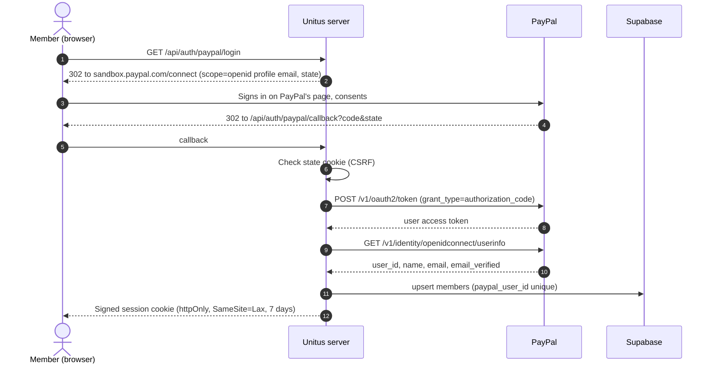
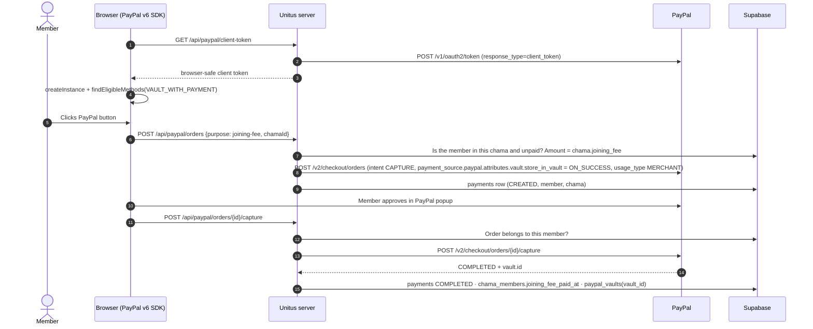
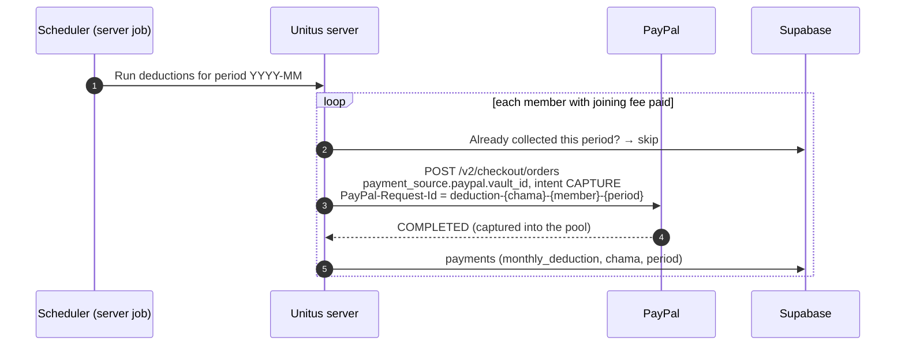
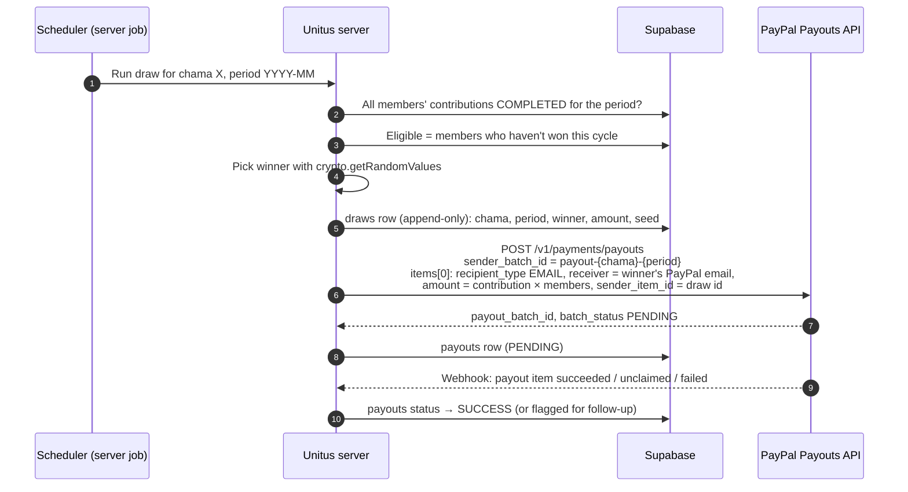

# Payments architecture

How money moves through Unitus, which PayPal APIs are involved, and who is allowed to do what.

> **Status legend:** ✅ built and tested in sandbox · 🛠 designed, not built yet

---

## 1. Accounts and roles

| Role | PayPal account | What it does |
|---|---|---|
| **Platform pool** | One PayPal **Business** account: the account that owns the app's REST credentials (`PAYPAL_CLIENT_ID` / `PAYPAL_CLIENT_SECRET`) | Receives every chama contribution (it's the payee of every order) and is the sender of every payout. Money is tracked per chama in the Supabase ledger, not by splitting PayPal accounts. |
| **Member** | The member's own **personal** PayPal | Logs in with PayPal, joins chamas, has their PayPal saved (vaulted) for monthly charges, and receives the payout on their turn. |
| **Chama admin (creator)** | The PayPal account they created the chama with | Creates the chama and shares invites. **Admin only:** this account can never be a member of that chama, can't pay into it and can't receive its payouts (enforced in the database, migration 0003). Its PayPal is never the pool. To take part, the person logs in with a **different** personal PayPal account and joins with the invite code. |
| **Partner business** | Its own PayPal Business account | Sells offers. Members pay it directly; this money never enters the pool. |

Business accounts can't sign in as members: PayPal doesn't share a Business account's profile through Log in with PayPal, and the login page asks for a personal account.

---

## 2. The four PayPal flows

### Flow A: Log in with PayPal ✅
OpenID Connect authorization-code flow. Gives us a stable identity and a verified email; no passwords stored.

The member's verified PayPal **email** recorded here is the address payouts are sent to (Flow D). Nobody can type in or change a payout address.

### Flow B: Joining fee + authorizing recurring charges (vault) ✅
A member authorizes future charges once, by paying the joining fee with PayPal's **vault-with-purchase** flow (JS SDK v6, `paymentFlow: "VAULT_WITH_PAYMENT"`). That single approval both pays the fee into the pool and stores a reusable **payment token** (vault id) for merchant-initiated charges.

- The amount always comes from the chama's locked rules on the server; the browser only says *what* it's paying for.
- The vault id is stored server-side only (Supabase, RLS on, no public access). The browser never sees it.

### Flow C: Monthly contribution, captured into the pool ✅
On the deduction day the server charges each paid-up member's saved PayPal. There's no buyer interaction: the member agreed when they vaulted in Flow B.

- **Amount** = the chama's `monthly_contribution + monthly_savings` (+ loan instalment 🛠, once loans are stored).
- **No double charges:** a fixed `PayPal-Request-Id` per chama, member and month. Tested in sandbox: simultaneous and repeated requests return the same order. The ledger check skips anything already collected.
- **Declines:** a declined charge isn't retried automatically under the same id. 🛠 The member gets a "pay this month manually" prompt (one-time order, Flow B without vaulting).
- Today the scheduler isn't built 🛠; a sandbox-only button on the dashboard triggers the same route for testing.

### Flow D: Draw and payout to the winner 🛠
When every member's contribution for the period is **COMPLETED** in the ledger, the server draws a winner and pays them with the **Payouts API** from the pool.

- **Pot** = `monthly_contribution × member_limit`. Savings stay in the pool for the share-out.
- **Recipient** = the winner's verified email from Flow A. It's never typed in, never editable.
- **Exactly once:** PayPal rejects a `sender_batch_id` reused within 30 days and returns the original payout; the `draws` table has one row per chama and period, enforced by a unique key, which covers beyond 30 days. 5xx responses are retried with the same `sender_batch_id`.
- **Status:** poll `GET /v1/payments/payouts/{payout_batch_id}`, and confirm with payout webhooks once a public HTTPS endpoint exists. Item statuses include `SUCCESS`, `UNCLAIMED`, `RETURNED`, `FAILED`, `BLOCKED` and `ONHOLD`; anything but `SUCCESS` is flagged for follow-up and never auto-resent to a different address.
- **Pool balance:** the payout only runs after that period's contributions are captured, so the pool always holds the pot first.

Savings **share-out** (mid-year / year end) and a **leaving member's** refund reuse Flow D: one batch, one item per member, with amounts from the ledger.

---

## Chama accounts and the ledger

Unitus holds all money in **one** PayPal Business account; each chama has **accounts inside Unitus**, kept with a double-entry ledger (migration `0006_ledger.sql`, code in `lib/ledger.ts`).

| Account | Number | Holds |
|---|---|---|
| PayPal pool | `UNT-POOL` | All real money at PayPal (debit-normal) |
| Unitus operating | `UNT-OPS` | Unitus's own money; covers any gap when PayPal's fee exceeds what the member paid |
| Merry-go-round pot | `UNT-<invite>-POT` | A chama's contributions awaiting payout |
| Member savings | `UNT-<invite>-<member>-SAV` | One member's savings in that chama |
| Locked joining fee | `UNT-<invite>-<member>-FEE` | One member's joining fee, returned when they leave |

- Each completed payment posts one transaction whose entries sum to zero, e.g. a $150 deduction that netted $150.00: pool +150, pot −100, member savings −50.
- The database enforces that every transaction balances, entries are append-only (corrections are reversing entries) and each payment posts once.
- **Invariant:** `UNT-POOL` = all chama accounts + `UNT-OPS`. Reconciling `UNT-POOL` against PayPal's real balance (🛠) detects money moved outside Unitus.
- Members and admins see the chama's accounts and statement on the dashboard and can download it as CSV.
- `scripts/ledger-backfill.mjs` posts existing payments, first recording PayPal's real fee for payments captured before fee tracking.

## Fees

Members pay PayPal's transaction fee on top, so each chama receives exactly the amount its rules say.

- **Charged** = the chama amount grossed up for PayPal's fee (`lib/fees.ts`): $100 → $104.37 at the sandbox rate of 3.9% + $0.30. Set `PAYPAL_FEE_PERCENT` / `PAYPAL_FEE_FIXED` for the live account's rate.
- Each order shows the fee as its own line item ("PayPal processing fee"), and members see it before paying.
- The ledger stores **principal** (credited to the member and chama), **fee_charged**, PayPal's **actual fee** and the **net** deposited, all from PayPal's `seller_receivable_breakdown` at capture.
- Member balances use the principal; the chama balance shows the **net actually in the pool**, so any gap between the expected and actual fee is visible rather than hidden.
- Partner-offer purchases pay the business directly; no Unitus fee is added.

## 3. Security and compliance rules

### Admin rights vs financial access
Group admin rights and the ability to move money are strictly separate. **No person (not a member, not a chama admin, not a Unitus operator using the app) can trigger, redirect or size a payout.**

| Action | Chama admin account | Member | Automated server job |
|---|:-:|:-:|:-:|
| Create chama / set rules (once) | ✅ | ✅ (that account becomes its admin) | |
| Join / be a member of the chama it administers | ❌ (DB trigger rejects) | ✅ | |
| Edit rules after creation | ❌ (DB trigger rejects) | ❌ | ❌ |
| Share invite code/link | ✅ | ✅ | |
| Pay own joining fee / authorize own vault | ❌ | ✅ | |
| Receive a payout | ❌ | ✅ (on their turn) | |
| Charge monthly contributions | ❌ | ❌ | ✅ |
| Choose the winner | ❌ | ❌ | ✅ random, recorded |
| Trigger or amend a payout | ❌ | ❌ | ✅ |
| Change where a payout goes | ❌ | ❌ | ❌ (always the winner's own PayPal email) |
| Withdraw from the pool | ❌ | ❌ | ❌ (only rule-defined payouts) |

How it's enforced:
- **Rules are immutable in the database:** a trigger rejects any update to a chama except its status.
- **The admin account is never a member:** `join_chama` refuses it and a trigger rejects any membership row for a chama's creator, so it can't pay in or be drawn for a payout.
- **Financial endpoints don't accept user sessions.** 🛠 The deduction, draw and payout jobs run behind a server-to-server secret (`CRON_SECRET`), invoked by a scheduler. There is no admin UI for them. The current sandbox "Run it now" button is for development only and must be disabled in production.
- **Amounts and recipients are derived, never supplied:** from locked rules, the ledger and the winner's PayPal identity. API inputs only carry ids.
- **Supabase is server-only:** RLS is on with no policies, the secret key never leaves the server, and the browser never sees vault ids.
- **Draws are append-only** 🛠 (trigger blocks update/delete), so a result can't be quietly changed.
- **Every money movement is recorded** in `payments` / `payouts` with PayPal ids and `debug_id` on errors.
- **Idempotency everywhere:** `PayPal-Request-Id` on orders, `sender_batch_id` on payouts.

### Compliance (must be checked before going live)
- **Holding pooled funds for others** and redistributing them can be regulated as money transmission or custody (for example, a payment-service licence from the Central Bank of Kenya, or MSB registration in the US). Get legal advice for each country you operate in.
- **PayPal's terms:** confirm with PayPal that pooling member funds in one Business account and paying out via Payouts is an approved use. Their multiparty / Commerce Platform products may be required for production.
- **Payouts in production** needs PayPal's approval, a verified Business account and enough balance.
- **Log in with PayPal in production** needs PayPal's review of the requested scopes.
- **Merchant-initiated charges** (Flow C) rely on the member's consent at vaulting: keep the consent screen's wording and the member's opt-in on record.

---

## 4. Where it lives in the code

| Concern | Code |
|---|---|
| PayPal REST client (token cache, idempotency, retries, `debug_id`) | `lib/paypal/server.ts` |
| Orders: joining fee (vault), offers, monthly deduction | `lib/paypal/orders.ts`, `app/api/paypal/orders/**`, `app/api/paypal/deductions` |
| Log in with PayPal | `lib/paypal/identity.ts`, `app/api/auth/paypal/**` |
| Browser SDK (v6) and button | `lib/paypal/client.ts`, `components/paypal/paypal-pay-button.tsx` |
| Ledger, vaults, members | `lib/db.ts`, `supabase/migrations/0001_*.sql` |
| Chamas, invites, locked rules | `lib/chamas.ts`, `supabase/migrations/0002_chamas.sql` |
| Draw + payout, scheduler, webhooks | 🛠 not built yet |
