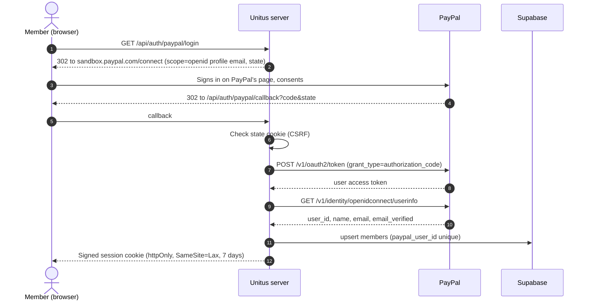
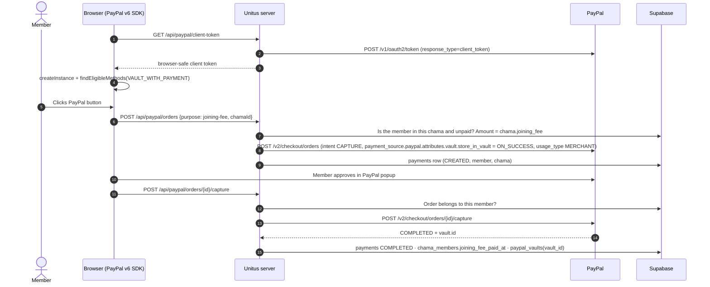
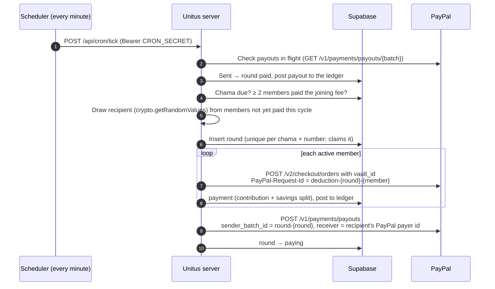

# Payments architecture

How money moves through Unitus, which PayPal APIs are involved, and who is allowed to do what.

> **Status legend:** ✅ built and tested in sandbox · 🛠 designed, not built yet

---

## 1. Accounts and roles

| Role | PayPal account | What it does |
|---|---|---|
| **Platform pool** | One PayPal **Business** account: the account that owns the app's REST credentials (`PAYPAL_CLIENT_ID` / `PAYPAL_CLIENT_SECRET`) | Receives every chama contribution (it's the payee of every order) and is the sender of every payout. Money is tracked per chama in the Supabase ledger, not by splitting PayPal accounts. |
| **Member** | The member's own **personal** PayPal | Logs in with PayPal, joins chamas, has their PayPal saved (vaulted) for monthly charges, and receives the payout on their turn. |
| **Chama admin (creator)** | The PayPal account they created the chama with | Creates the chama and shares invites. **Admin only:** this account can never be a member of that chama, can't pay into it and can't receive its payouts (enforced in the database, migration 0003). Its PayPal is never the pool. To take part, the person logs in with a **different** personal PayPal account and joins with the invite code. |
| **Partner business** | Its own PayPal Business account | Sells offers. Members pay it directly; this money never enters the pool. |

Business accounts can't sign in as members: PayPal doesn't share a Business account's profile through Log in with PayPal, and the login page asks for a personal account.

---

## 2. The four PayPal flows

### Flow A: Log in with PayPal ✅
OpenID Connect authorization-code flow. Gives us a stable identity and a verified email; no passwords stored.

The member's PayPal payer id (captured on their first payment) is where payouts are sent, falling back to the verified **email** recorded here. Nobody can type in or change a payout address.

### Flow B: Joining fee + authorizing recurring charges (vault) ✅
A member authorizes future charges once, by paying the joining fee with PayPal's **vault-with-purchase** flow (JS SDK v6, `paymentFlow: "VAULT_WITH_PAYMENT"`). That single approval both pays the fee into the pool and stores a reusable **payment token** (vault id) for merchant-initiated charges.

- The amount always comes from the chama's locked rules on the server; the browser only says *what* it's paying for.
- The vault id is stored server-side only (Supabase, RLS on, no public access). The browser never sees it.

### Flows C + D: Rounds — collect, draw, pay out ✅
A chama runs in **rounds** on its chosen schedule: every 30 minutes (sandbox testing only), daily, every 3 days, weekly, every 2 weeks or monthly. A scheduler calls `POST /api/cron/tick` every minute (`pnpm scheduler` locally; a cron service when deployed), protected by `CRON_SECRET`. Code: `lib/rounds.ts`.

- **Starting:** the first round runs at `starts_at` once **2 members** have paid the joining fee; until then it waits. The chama keeps accepting members while it runs, up to `member_limit`.
- **Who pays:** each round, every active member pays the contribution, the recipient included, and everyone pays savings. The recipient receives the whole pot, their own contribution too, in their Unitus wallet (migration 0010); withdrawals from the wallet go out as PayPal payouts. A member who received **before the recipient joined** doesn't pay into the recipient's round (the recipient never paid them). Over a cycle every member's contributions paid and received net to zero, including late joiners.
- **Loans (migration 0011):** a member can borrow once they've saved in 4 rounds, missed no round payment since their first, and have no loan open in any chama. The limit is 25% of their savings, +5% per loan repaid without missing a round, up to the chama's multiplier, and capped by the chama's savings not already lent. `request_loan` posts the loan receivable (`UNT-<code>-<member>-LOAN`, debit) for principal + flat interest, credits the principal to the member's wallet and the interest to the chama's interest account (`UNT-<code>-INT`). Each round adds the next instalment to the member's PayPal charge (only loans taken before the round started, so a retried charge asks for the same amount); `ledger_post_payment` credits it to the receivable and marks the loan repaid when it's all back.
- **Cycles:** a cycle ends when every active member has received once; the next round starts a new cycle with everyone.
- **Pot** = contributions actually collected in that round. A declined member's share is missing (logged); the round still pays out what was collected.
- **Exactly once:** the round row is unique per chama and number; deductions reuse a request id per round and member; the payout batch id is the round id. A tick that stops halfway is finished by the next tick.
- **Late scheduler:** if more than one round behind, the next round runs now instead of several at once.
- **Payout fee:** PayPal charges the sender (2% in the sandbox). Unitus covers it from `UNT-OPS`; it's recorded on the round and in the ledger.
- **Ledger:** contributions go to the chama's pot, savings to the member's savings; the payout debits the pot and the pool.
- **Sandbox:** `pnpm scheduler --once --force <chamaId>` runs a chama's next round immediately. Refused in production.
- **Declines:** not retried automatically. 🛠 A "pay this round manually" prompt.

Savings **share-out** (mid-year / year end) 🛠 and a **leaving member's** refund 🛠 will reuse the payout step: one batch, one item per member, with amounts from the ledger.

---

## Chama accounts and the ledger

Unitus holds all money in **one** PayPal Business account; each chama has **accounts inside Unitus**, kept with a double-entry ledger (migration `0006_ledger.sql`, code in `lib/ledger.ts`).

| Account | Number | Holds |
|---|---|---|
| PayPal pool | `UNT-POOL` | All real money at PayPal (debit-normal) |
| Unitus operating | `UNT-OPS` | Unitus's own money; covers any gap when PayPal's fee exceeds what the member paid |
| Merry-go-round pot | `UNT-<invite>-POT` | A chama's contributions awaiting payout |
| Member savings | `UNT-<invite>-<member>-SAV` | One member's savings in that chama |
| Locked joining fee | `UNT-<invite>-<member>-FEE` | One member's joining fee, returned when they leave |

- Each completed payment posts one transaction whose entries sum to zero, e.g. a $150 deduction that netted $150.00: pool +150, pot −100, member savings −50.
- The database enforces that every transaction balances, entries are append-only (corrections are reversing entries) and each payment posts once.
- **Invariant:** `UNT-POOL` = all chama accounts + `UNT-OPS`. Reconciling `UNT-POOL` against PayPal's real balance (🛠) detects money moved outside Unitus.
- Members and admins see the chama's accounts and statement on the dashboard and can download it as CSV.
- `scripts/ledger-backfill.mjs` posts existing payments, first recording PayPal's real fee for payments captured before fee tracking.

## Fees

Members pay PayPal's transaction fee on top, so each chama receives exactly the amount its rules say.

- **Charged** = the chama amount grossed up for PayPal's fee (`lib/fees.ts`): $100 → $104.37 at the sandbox rate of 3.9% + $0.30. Set `PAYPAL_FEE_PERCENT` / `PAYPAL_FEE_FIXED` for the live account's rate.
- Each order shows the fee as its own line item ("PayPal processing fee"), and members see it before paying.
- The ledger stores **principal** (credited to the member and chama), **fee_charged**, PayPal's **actual fee** and the **net** deposited, all from PayPal's `seller_receivable_breakdown` at capture.
- Member balances use the principal; the chama balance shows the **net actually in the pool**, so any gap between the expected and actual fee is visible rather than hidden.
- Partner-offer purchases pay the business directly; no Unitus fee is added.

## 3. Security and compliance rules

### Admin rights vs financial access
Group admin rights and the ability to move money are strictly separate. **No person (not a member, not a chama admin, not a Unitus operator using the app) can trigger, redirect or size a payout.**

Any signed-in member can create a chama; no separate PayPal account is needed (migration 0009). Creating one opens the chama's account inside Unitus (`UNT-<invite code>`); the money itself sits in the Unitus pool. A member can be in as many chamas as they like, and a creator can also join their own chama as an ordinary member.

| Action | As the chama's admin (creator) | As a member | Automated server job |
|---|:-:|:-:|:-:|
| Create chama / set rules (once) | ✅ | | |
| Edit rules after creation | ❌ (DB trigger rejects) | ❌ | ❌ |
| Share invite code/link | ✅ | ✅ | |
| Pay own joining fee / authorize own vault | only by joining as a member | ✅ | |
| Receive a payout | only by joining as a member, on their turn | ✅ (on their turn) | |
| Charge monthly contributions | ❌ | ❌ | ✅ |
| Choose the winner | ❌ | ❌ | ✅ random, recorded |
| Trigger or amend a payout | ❌ | ❌ | ✅ |
| Change where a payout goes | ❌ | ❌ | ❌ (always the winner's own PayPal email) |
| Withdraw from the pool | ❌ | ❌ | ❌ (only rule-defined payouts) |

How it's enforced:
- **Rules are immutable in the database:** a trigger rejects any update to a chama except its status.
- **Admin rights never include money:** a creator who joins is treated exactly like any member (same charges, same random draw). Nothing an admin can do in the app moves money.
- **Financial endpoints don't accept user sessions:** deductions, draws and payouts run only in the scheduler tick, behind a server-to-server secret (`CRON_SECRET`). There is no admin UI for them; forcing a round is sandbox-only.
- **Amounts and recipients are derived, never supplied:** from locked rules, the ledger and the winner's PayPal identity. API inputs only carry ids.
- **Supabase is server-only:** RLS is on with no policies, the secret key never leaves the server, and the browser never sees vault ids.
- **Draws are append-only** 🛠 (trigger blocks update/delete), so a result can't be quietly changed.
- **Every money movement is recorded** in `payments` / `payouts` with PayPal ids and `debug_id` on errors.
- **Idempotency everywhere:** `PayPal-Request-Id` on orders, `sender_batch_id` on payouts.

### Compliance (must be checked before going live)
- **Holding pooled funds for others** and redistributing them can be regulated as money transmission or custody (for example, a payment-service licence from the Central Bank of Kenya, or MSB registration in the US). Get legal advice for each country you operate in.
- **PayPal's terms:** confirm with PayPal that pooling member funds in one Business account and paying out via Payouts is an approved use. Their multiparty / Commerce Platform products may be required for production.
- **Payouts in production** needs PayPal's approval, a verified Business account and enough balance.
- **Log in with PayPal in production** needs PayPal's review of the requested scopes.
- **Merchant-initiated charges** (rounds) rely on the member's consent at vaulting: keep the consent screen's wording and the member's opt-in on record.

---

## 4. Where it lives in the code

| Concern | Code |
|---|---|
| PayPal REST client (token cache, idempotency, retries, `debug_id`) | `lib/paypal/server.ts` |
| Orders: joining fee (vault), offers, monthly deduction | `lib/paypal/orders.ts`, `app/api/paypal/orders/**`, `app/api/paypal/deductions` |
| Log in with PayPal | `lib/paypal/identity.ts`, `app/api/auth/paypal/**` |
| Browser SDK (v6) and button | `lib/paypal/client.ts`, `components/paypal/paypal-pay-button.tsx` |
| Ledger, vaults, members | `lib/db.ts`, `supabase/migrations/0001_*.sql` |
| Chamas, invites, locked rules | `lib/chamas.ts`, `supabase/migrations/0002_chamas.sql` |
| Draw + payout, scheduler, webhooks | 🛠 not built yet |
